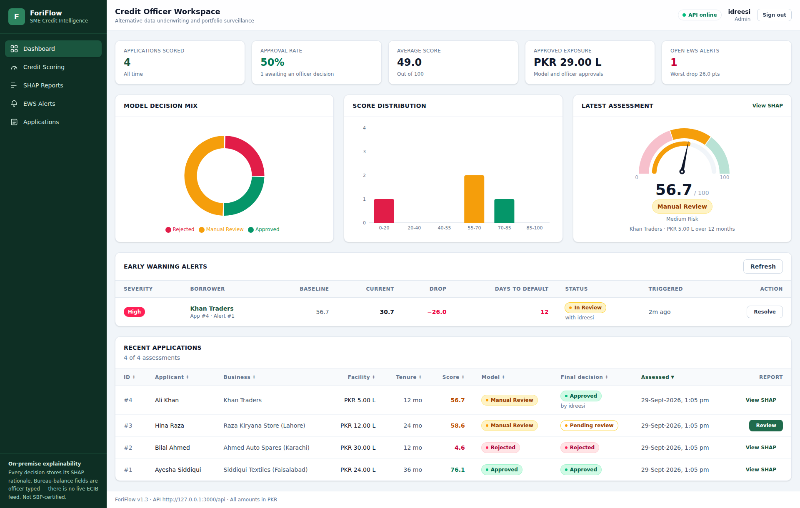
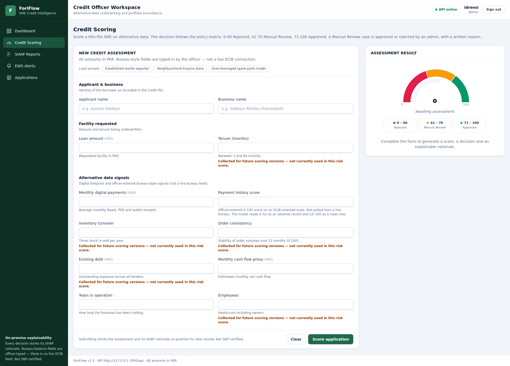
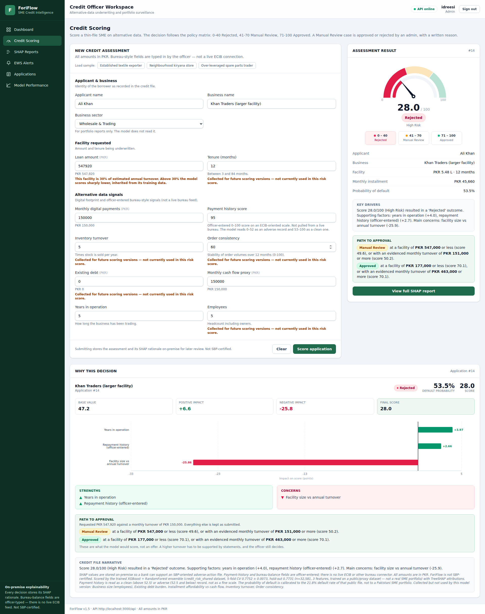
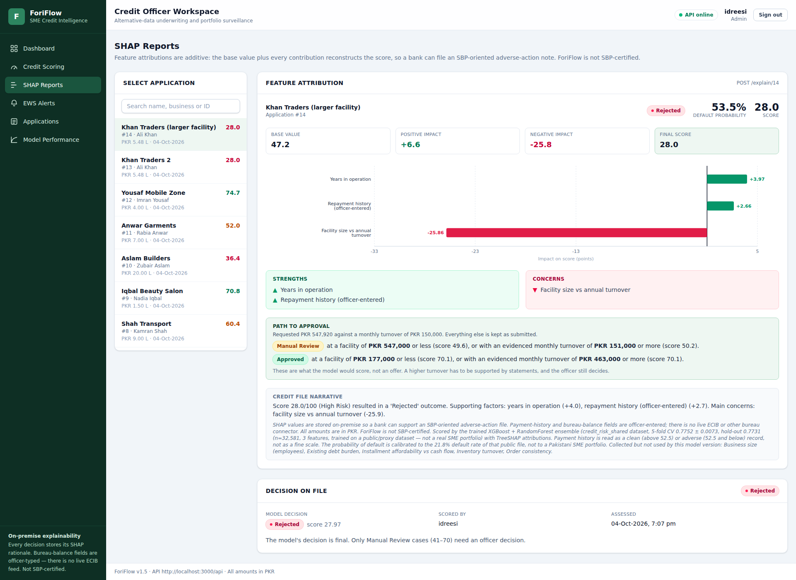
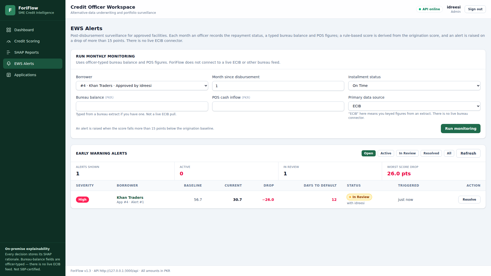
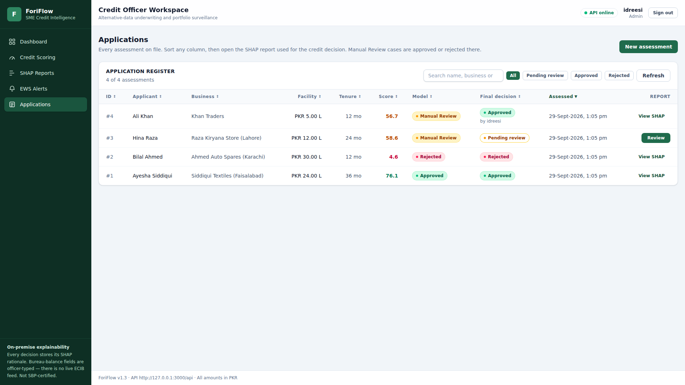
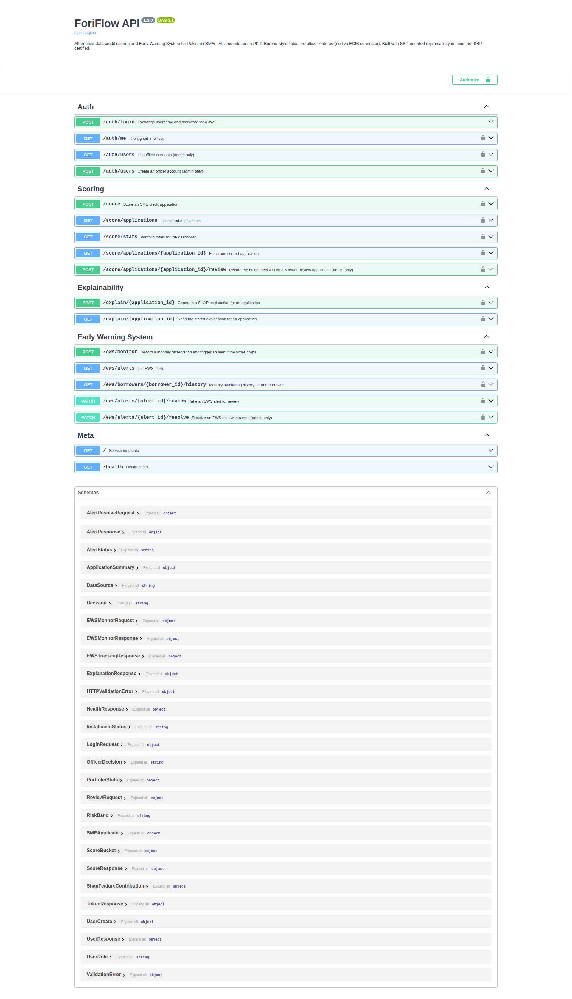
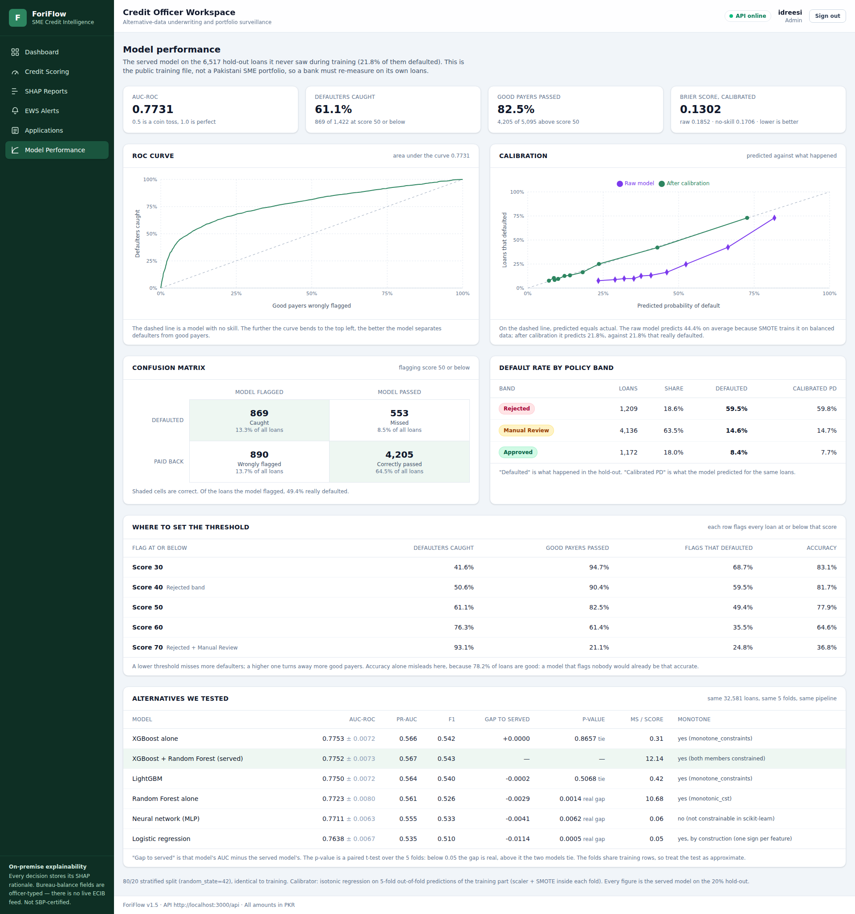

# ForiFlow 🏦🤖

> AI-Powered SME Credit Scoring & Early Warning System for Pakistani Banks

[](https://fastapi.tiangolo.com)
[](https://react.dev)
[](https://xgboost.readthedocs.io)
[](https://shap.readthedocs.io)
[](https://www.docker.com)

## 🎯 Problem Statement

Pakistani SMEs face a financing gap:

- Many have no collateral and a thin or informal credit file, so a collateral-led
  scorecard has little to go on
- Their digital footprint (Raast, POS and wallet receipts) is rarely part of the
  credit decision
- Deterioration after disbursement is often noticed only once installments are
  already late
- Lenders need to explain automated credit decisions. The State Bank of Pakistan
  was reported in April 2025 to be finalising guidelines for responsible AI use in
  financial services, aimed at "trust, transparency, and accountability"
  ([Dawn](https://www.dawn.com/news/1906849)); no final SBP rule mandating
  explainable AI for credit decisions has been verified for this project

## 💡 Solution

ForiFlow is an end-to-end AI credit intelligence platform that:

- Scores unbanked SMEs using **alternative data** (digital payments and other officer-entered signals)
- Gives a risk assessment and a policy **recommendation**; an authorised credit officer makes every decision
- Provides **SHAP explainability** for every assessment, stored on-premise to support an SBP-oriented review (ForiFlow is not SBP-certified and has no live ECIB connector)
- Monitors approved facilities with an **Early Warning System**: deterministic, rule- and trend-based monitoring of officer-recorded months (repayment, typed bureau balance, POS inflow). It keeps an immutable monthly history, shows where every score came from, computes a trend from three months, explains each NORMAL / WATCH / WARNING / CRITICAL state with evidence, and runs an audited alert lifecycle. It recommends follow-up; it does not predict default or change any facility

## 🏗️ Architecture

```
┌─────────────┐      REST API       ┌─────────────┐
│   React 18  │ ◄─────────────────► │   FastAPI   │
│  Dashboard  │   /score /explain   │   Backend   │
└─────────────┘                     └──────┬──────┘
                                           │
                 ┌─────────────────────────┼─────────────────────────┐
                 ▼                         ▼                         ▼
          ┌─────────────┐           ┌─────────────┐           ┌─────────────┐
          │ XGBoost+RF  │           │    SHAP     │           │ PostgreSQL  │
          │  Ensemble   │           │TreeExplainer│           │     16      │
          │ CV 0.7743*  │           │             │           │  (Docker)   │
          └─────────────┘           └─────────────┘           └─────────────┘
```

\* Final test set 0.7748 (5-fold CV on the training split 0.7743 ± 0.0073; 3 features; a demonstration model trained on public consumer credit data — not validated for Pakistani SME lending).

In Docker the dashboard calls `/api` on its own origin and nginx forwards that
prefix to FastAPI, so a bank laptop never has to configure CORS.

## ✨ Key Features

| Feature | Description |
|---------|-------------|
| 🎯 **AI Credit Scoring** | XGBoost + Random Forest soft-voting ensemble. Score: 0-100 |
| 🔎 **ML input checks and sensitivity** | An additional 128-tree Isolation Forest flags unusual input combinations. Saved-case checks verify the credit artefacts and reproduce the recorded score before showing learner disagreement, clipping and 25 actual ensemble scenarios. Hypothetical controls never change a loan or decision. [Method and verification](docs/ml-diagnostics-2026-10-27.md) |
| 📝 **Check inputs before saving** | Inspect five numerical model inputs directly on the assessment form, without sending identity fields or creating a borrower, score or assessment. Changes, statement reads and cancellation invalidate old results. [Verification](docs/input-checks-2026-10-27.md) |
| 📊 **SHAP Waterfall Charts** | Every assessment explained with feature attribution, plus coded top risk factors (R01, R02, …) |
| 📈 **Model page & model card** | Leakage-free protocol (train / validation / untouched final test), baselines (logistic regression, XGBoost, random forest), display-only calibrated PD, data-quality report, model evaluation thresholds shown apart from the credit policy, and a [model card](docs/model_card.md) |
| 🧭 **Path to approval** | For a rejected or referred applicant, the exact facility size and the evidenced turnover at which the same business would reach the next band, found by searching the monotone model |
| 🧾 **Turnover from a statement** | Upload a wallet or bank statement CSV; ForiFlow computes monthly turnover from the transactions, flags what to check, and records on the credit file whether the scored figures match the statement |
| 🧮 **Statement cash-flow resilience** | Replay recorded months at 0%, 10%, 20% and 30% lower inflows, holding outflows fixed and subtracting new principal divided by tenure. Results and source fingerprints stay with the assessment and memo. Interest and fees are excluded; this is a sensitivity check, not a repayment forecast or approval |
| 📨 **Payment reminders** | First unrecorded installment overdue or due within a week, plus shortfalls in recorded amounts. Gaps and unknown amounts are explicit. Drafts in English and Roman Urdu retain paisa; the indicative principal-only schedule needs officer verification |
| 📉 **Population drift monitor** | Population Stability Index of the score and each model input against the training data, with the value chance alone would give at that sample size, so a small portfolio is not misread as drift |
| 🧑‍⚖️ **Decision support, not auto-approval** | The model gives a risk assessment, a versioned and configurable credit policy turns it into a recommendation, and an authorised officer makes the decision. No score approves or rejects a loan |
| **Reviewed policy changes** | Compare versioned terms, start drafts from active terms and review activation with a reason. Current-account checks and stale-policy rejection protect reviewed changes; existing assessments retain their original rules. [Workflow and compatibility](docs/policy-review-2026-10-29.md) |
| 🧾 **Traceability** | Every application is filed under a borrower (one business, many applications, full history), stores the model version and engine that scored it, and every action is written to an append-only audit trail the database itself refuses to edit |
| ⚖️ **Subgroup Performance Analysis** | Count, default rate, ROC-AUC, precision and recall per age band, income quarter, housing status and loan purpose on the final test set; small groups marked "Insufficient sample size"; states what cannot be analysed (no gender in the data) |
| 🖨️ **Credit memo** | A printable record per application: request, score, factor points, turnover evidence, cash-flow scenarios, decision and reason |
| 💼 **Loan book analytics** | Disbursed, collected, overdue and outstanding amounts, portfolio at risk (30+ days), defaults, a decision matrix and a per-sector table, from the months officers record |
| ✅ **Officer decision on every application** | A manager or admin approves, rejects or escalates each application with a written reason, whatever the policy recommended; the recommendation, the officer's decision, name and time are all kept, and only approved facilities can be monitored |
| 🚨 **Early Warning System** | Immutable monthly history with score provenance, OLS trend from three months, six evidence-backed signals, NORMAL / WATCH / WARNING / CRITICAL states, one open alert per facility with an audited lifecycle (acknowledge, assign, due date, action, resolve, dismiss). Rule-based, not a default model ([docs/ews.md](docs/ews.md)) |
| 🏦 **PKR Banking Context** | PKR amounts; designed for SBP-oriented explainability (not SBP-certified, no live ECIB feed) |
| 🐳 **Docker Ready** | One-command deployment for bank demos |
| 🔐 **JWT Authentication** | On-premise login (bcrypt, HS256, 8-hour tokens, sign-out revocation, lockout after 5 wrong passwords, admin-disabled accounts); three roles (analyst, manager, admin): managers decide Manual Review cases (approving up to a configurable facility limit) and resolve alerts, admins also manage officer accounts; every assessment records who scored it. Security baseline and limits: [SECURITY.md](SECURITY.md) |

## 🛠️ Tech Stack

| Layer | Technology |
|-------|-----------|
| **Frontend** | React 18, Vite, Tailwind CSS, Recharts, Axios |
| **Backend** | Python 3.12, FastAPI, SQLAlchemy 2, Pydantic 2, Alembic, PyJWT, passlib/bcrypt |
| **ML** | XGBoost 3.4, scikit-learn 1.8 (Random Forest), SHAP TreeExplainer, imbalanced-learn (SMOTE) |
| **Database** | PostgreSQL 16 in Docker (schema owned by Alembic); SQLite only for runs without Docker and for tests |
| **DevOps** | Docker, Docker Compose, nginx (serves the dashboard, proxies `/api`), GitHub Actions |

## 📸 Screenshots











## 🚀 Quick Start

```bash
git clone https://github.com/Idreesi8/foriflow.git
cd foriflow
docker compose up --build -d
```

Visit: [http://127.0.0.1:3000](http://127.0.0.1:3000)

On Windows, double-click `start.bat` (or the desktop **ForiFlow** shortcut
from `create-shortcut.bat`). That starts existing images without rebuilding.
After code changes, use `rebuild.bat`.
To see what is stored in PostgreSQL (applications with their SHAP explanations,
EWS records, alerts, bcrypt-hashed officer accounts), run `show-data.bat`; the
read-only queries are in `scripts/show-data.sql`.
Confirm the trained ensemble is live with:

```bash
docker compose logs backend | grep "Scoring engine ready"
```

You want `ensemble-xgb-rf-...`, not `surrogate-linear-v1`. The trained
artefacts are committed in `backend/ml/`, so a fresh clone serves the real
ensemble. To retrain them, see "Training data" in
[`backend/README.md`](backend/README.md).

Without Docker: `uvicorn main:app --port 8000` in `backend/` and `npm run dev`
in `frontend/`. Vite proxies `/api` to the API.

Native Windows inference now reads the shipped XGBoost snapshot's original
portable model bytes without restoring Linux-specific training RNG state.
Missing or unloadable trained artifacts stop production startup; in development
the formula fallback is labelled and `/health` reports degraded status.
An explicitly selected demonstration engine remains available. The model was
not retrained and its published predictive metrics have not changed.
See the [22 October improvements and verification report](docs/improvements-2026-10-22.md).
The [follow-up reliability report](docs/continuation-2026-10-22.md) covers
reminder coverage, page recovery and startup fixes.
The [database and recovery report](docs/database-verification-2026-10-22.md)
records native PostgreSQL integration and backup/restore verification.
The subsequent [Docker recovery report](docs/docker-repair-2026-10-22.md)
records the runtime repair and verification against the existing container database.
The [Action Desk report](docs/action-desk-2026-10-24.md) describes the officer
worklist, evidence-based priorities and focused case navigation.
The [officer role filter](docs/role-worklist-2026-10-27.md) lets officers focus
on tasks their current account role can act on, while retaining complete
portfolio counts and existing approval limits.
The [workday navigation update](docs/workday-navigation-2026-10-28.md) preserves
applied filters and pages across case work and makes the dashboard's next
actions relevant to the signed-in officer's role.
The [assessment review update](docs/assessment-review-2026-10-28.md) provides
an unsaved review of exact figures and statement evidence before the officer
explicitly saves a new assessment.
The [officer access update](docs/team-access-2026-10-29.md) adds reviewed role
changes, account search/filtering, access history and protection against
simultaneous cross-admin access removal.
The [reminder review update](docs/reminder-review-2026-10-29.md) adds search,
record-check filters, direct case links and a fresh-read draft review before
copying or opening WhatsApp. No message is automatically sent.
The [feature-engineering study](docs/feature-engineering-2026-10-28.md) compares
four candidates on the original training rows only, measures input dependence
and reports the results in Model. No replacement model was justified or deployed.

The [Cash-flow Intelligence workspace](docs/cashflow-intelligence-2026-10-28.md)
adds local robust trends, four receipt forecasting methods, separate development /
calibration / later evaluation blocks and explicit empirical error ranges.
It analyses statements without scoring or saving a credit case.
Its [source-quality checks](docs/cashflow-source-quality-2026-10-28.md) require
an explicit convention when numeric dates need a guess, and show repeated-row
candidates with source line references while retaining their transactions.

The [additional-fields update](docs/operating-fields-2026-10-28.md) puts tenure,
debt, inventory, consistency and headcount to work in separate business checks,
and records acquired SME datasets with exact schema, provenance and training gaps.
The [monitoring calendar report](docs/monitoring-calendar-2026-10-24.md) covers
month coverage, explicit corrections and safer facility switching.
The [workspace usability report](docs/user-experience-2026-10-24.md) covers the
new dashboard, workspace search, mobile navigation and guided assessment form.
The [complete register report](docs/complete-register-2026-10-26.md) covers finding
older cases, whole-register sorting, mobile case cards and retained search context.
The [work protection report](docs/work-protection-2026-10-26.md) covers unsaved
entries, statement-read races and decision-response reconciliation.
The [Pakistan time report](docs/pakistan-time-2026-10-26.md) covers consistent
observation dates, overdue flags, deadlines, reminder anchors and PKT displays.
The [decision review report](docs/decision-review-2026-10-27.md) covers explicit
credit-action confirmation, refreshed authority and read-only supporting evidence.

## 📊 Performance

- **AUC-ROC:** final test set 0.7748 (6,484 loans, measured once); 5-fold CV on the training split 0.7743 ± 0.0073 (3 features, public consumer credit data — not a real SME portfolio). Logistic regression reaches 0.7630 and XGBoost alone 0.7744: the ensemble adds nothing meaningful over XGBoost alone. 0.85+ remains a bank-data target, not a measured result.
- **Calibration (final test):** Brier 0.1845 raw → 0.1304 with an isotonic calibrator chosen and fitted on the validation split (0.1709 for always predicting the base rate). Display only; calibrated to the public file's 21.9% default rate, not to Pakistani SMEs.
- **Response time:** median 150 ms, p90 207 ms per score including SHAP (30 runs in the Docker container on the development laptop, 26 September 2026)
- **Concurrency:** not load-tested; the shipped Compose stack runs a single uvicorn process behind nginx, sized for a single-branch pilot

## 📁 Project Structure

```
foriflow/
├── backend/           # FastAPI + ML
├── frontend/          # React Dashboard
├── docker-compose.yml
├── docs/              # Architecture, API, deployment
├── linkedin/          # Profile copy and launch posts
└── scripts/           # Screenshot capture and repo setup
```

## 🗺️ Roadmap

- [x] MVP with real ML model
- [x] Docker containerization
- [x] SHAP explainability
- [x] EWS monitoring
- [x] JWT authentication with admin and analyst roles
- [x] PostgreSQL 16 with Alembic migrations
- [ ] Retrain on labelled Pakistani SME loan data
- [ ] ECIB integration
- [ ] Mobile responsive + Urdu support

## 👤 Author

**Ramzan Idreesi** — AI Software Engineer | Full-Stack Developer

[GitHub](https://github.com/Idreesi8) · [LinkedIn](https://www.linkedin.com/in/ramzan-idreesi-0b0245328)

## 📄 License

MIT License © 2026 Ramzan Idreesi
